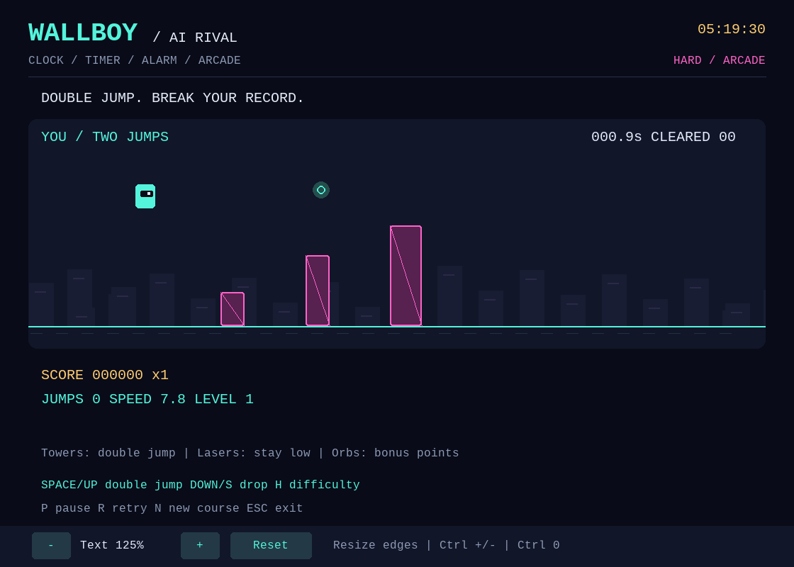
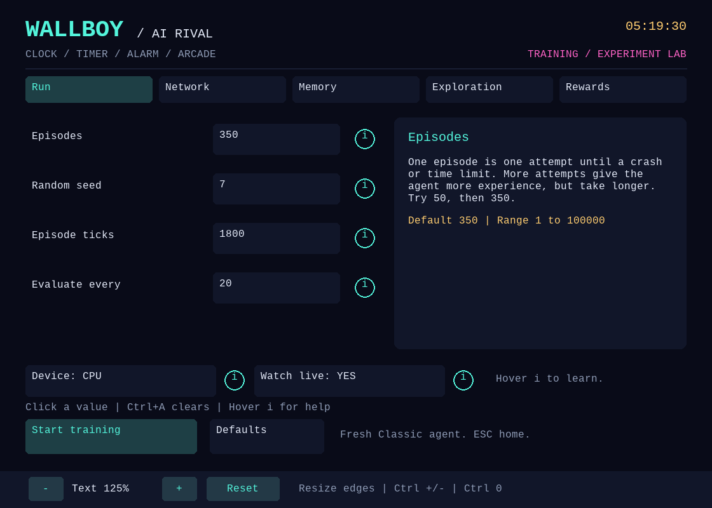
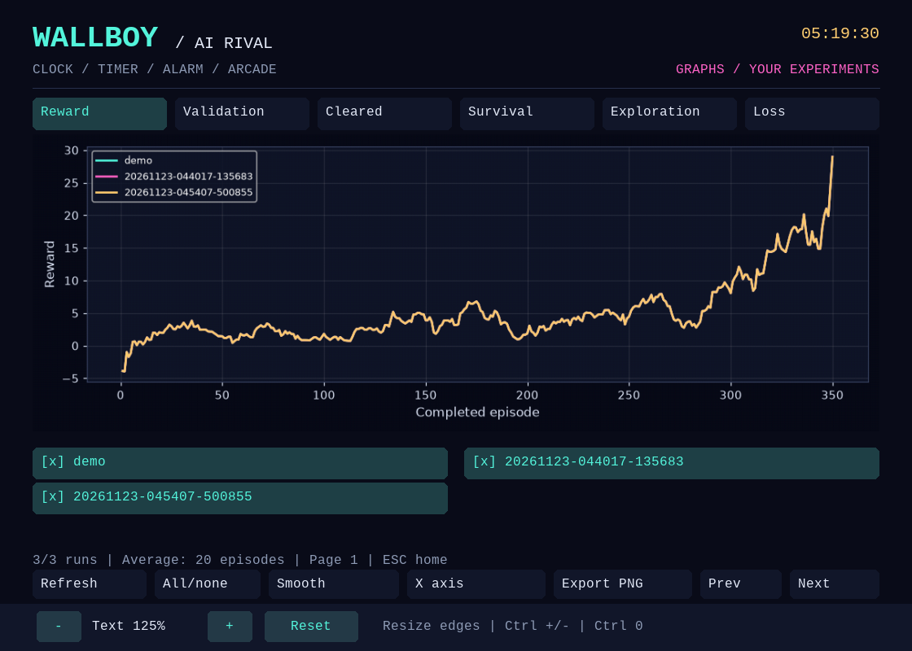

# WallBoy · AI Rival

**A reinforcement-learning playground I'm actively building to understand how an agent learns.**

I'm connecting the look of my C++ Wallboy clock/timer/alarm project with a cyberpunk runner. The goal is to make the learning process visible: start with random weights, watch a small DQN learn when to jump, change one setting, and compare what happens.

<p align="center"></p>

**Python · PyTorch · Pygame · C++17 export**

## What works today

- A readable DQN with experience replay, a target network, exploration decay and held-out evaluation. Actions come from learned Q values, not scripted jump rules.
- A training lab with 19 adjustable parameters and an information button explaining each one: learning rate, discount, network size, replay memory, exploration and rewards.
- Live training, manual play, trained-policy playback and a race against the bot.
- A separate harder arcade mode with double jumps, fast falls, lasers, bonus orbs and levels. Speed and obstacle density increase within bounded limits.
- One comparison graph with a colored line per saved run. Switch metrics, hide runs, compare by episode or decision count, smooth the data and export an image.
- Resizable windows and adjustable text size, with preferences saved locally.
- Export of learned weights to JSON and a dependency-free C++ header, with a verifier that compares C++ and PyTorch outputs.

## Work in progress

<table><tr><td width="50%"><br><sub>The experiment lab: change a value and understand what it controls.</sub></td><td width="50%"><br><sub>Three saved runs on one graph. These repeated runs have matching curves, so their lines overlap; this is not evidence that different settings perform equally.</sub></td></tr></table>

These are captures of the project's Pygame screens and recorded data. The graph includes the bundled demo and two local runs; the personal run folders are not included in the repository.

**Current boundary:** the trained agent uses the original single-jump Classic environment. The double-jump arcade game is playable manually; its expanded observations and actions are a future RL exercise. The C++ policy export is tested, but integration into the original clock/timer/alarm application is still planned.

Next, I want to compare controlled experiments across several seeds, understand which settings matter, and teach a policy the harder game. This is a learning project developed with AI assistance, with tests and saved experiment data to check the results.

## Try it

Python 3.11–3.13 is a practical starting point. CPU is supported; a GPU is optional.

```bash
git clone https://github.com/erudaperu/WallBoy.git
cd WallBoy
./setup.sh
./run.sh
```

The setup script installs dependencies in this project's `.venv`, without changing other Python or AI environments. If a compatible environment is already present, it can be reused. See the [full learning guide](docs/LEARNING_GUIDE.md) for Fedora setup, observations/actions/rewards, training and export.

- **TRAIN** opens the settings lab. Hover or click a circled `i` for an explanation. Start training creates a fresh run.
- **GRAPHS** reads saved runs from `runs/` and overlays them. A fresh clone includes one demo; your experiments add more lines.
- Use the bottom **− / +** buttons or **Ctrl− / Ctrl+** for text size. Drag the window edges or maximize it.

```bash
./run.sh settings
./run.sh graphs
./run.sh train --learning-rate 0.0001 --seed 7 --out runs/lr-experiment
./run.sh watch --model runs/lr-experiment/best.pt
./run.sh export --model runs/lr-experiment/best.pt --out exports/my-policy
```

For a first experiment, change only the learning rate and keep the seed fixed. Then repeat across several seeds. Compare validation performance and obstacles cleared; if reward rules change, raw reward totals are no longer directly comparable.

## Read the code

| Part | File |
|---|---|
| Classic physics, observations and rewards | [`env.py`](wallboy/env.py) |
| Q network, replay memory and DQN updates | [`agent.py`](wallboy/agent.py) |
| Training and saved experiments | [`train.py`](wallboy/train.py) |
| Setting definitions and explanations | [`settings.py`](wallboy/settings.py) |
| Training form and graph controls | [`lab_ui.py`](wallboy/lab_ui.py) |
| Saved-run comparison curves | [`history.py`](wallboy/history.py) |
| Window scaling, text and game drawing | [`ui.py`](wallboy/ui.py) |
| Harder manual arcade physics | [`challenge.py`](wallboy/challenge.py) |
| Portable learned-policy export | [`export.py`](wallboy/export.py) |

## Verification

The current checkout passes **24 tests**, covering physics, actual neural updates, checkpoint loading, configurable training, display controls and graph data. A 16-neuron-per-layer export passed **287 C++/PyTorch parity observations**, with matching actions. A short integration run checks training and saving; it is not a claim of learning quality.

```bash
.venv/bin/python -m unittest discover -s tests -v
```

See [verification notes](VERIFICATION.md) for earlier demo results, limitations and the distinction between simulated checks and desktop verification.
