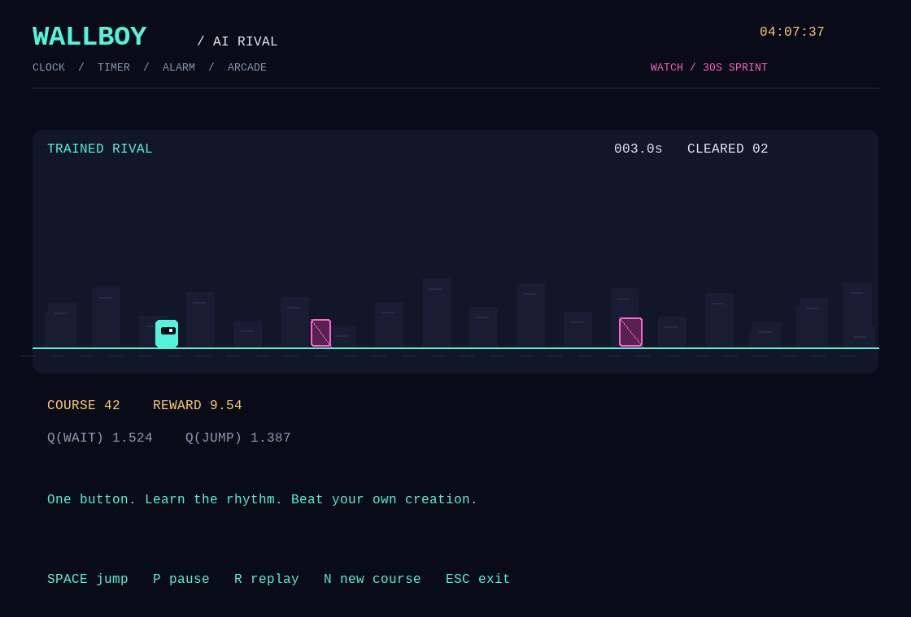
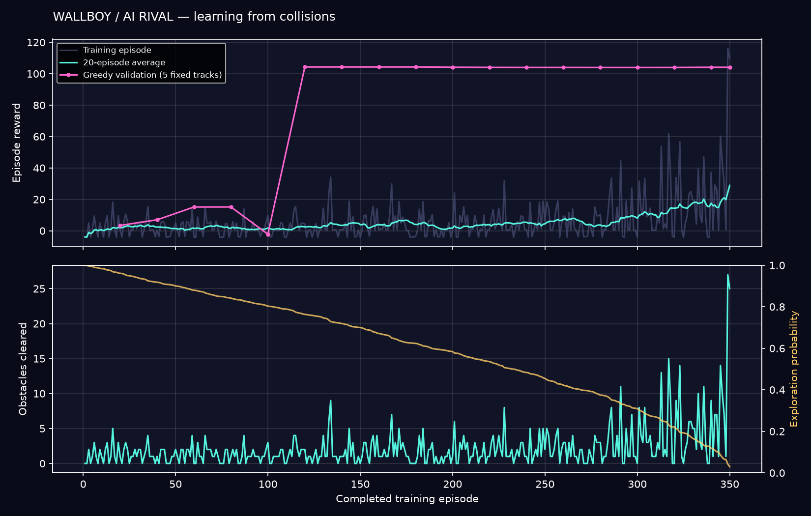

# Wallboy AI Rival

## Resize, learn, compare

Drag a window edge or maximize it. The scene scales without changing physics.
Use the bottom **− / +** controls (or **Ctrl+− / Ctrl++**) to change text size
from 80% to 175%; **Ctrl+0** restores 125%. Window size and text size are
remembered in `runs/display-settings.json` when you close a screen.

**Train** now opens the experiment lab. Its five tabs expose run length and seed,
learning rate, future discount, hidden-layer width, gradient clipping, replay
memory, batch size, warm-up, target updates, exploration and all four rewards.
Hover or click each circled **i** to read what it does and what to try.
Click a number, press Ctrl+A to clear it, and type the replacement.
**Start training** creates a fresh agent and a unique saved run. Defaults restores
the original DQN settings. Training still uses Classic, the one-jump environment.

**Graphs** draws all your saved runs as separate colored lines **on one graph**.
Click run names to show/hide lines. Choose Reward, Validation, Cleared, Survival,
Exploration or Loss. Smooth toggles raw values/20-point averages; X axis switches
between completed episodes and agent decisions. Refresh discovers new CSV data.
Export PNG saves the current comparison in `runs/`. Existing runs are preserved;
the graph reads their actual CSV data and never invents missing values.

Start by changing just learning rate: run the same seed at 0.0005, then 0.0001.
Compare Validation and Cleared. Try several seeds before drawing conclusions.
If you change rewards or episode length, reward totals mean different things;
use Cleared and Survival too. A short test run proves the code runs, not that an
agent has learned. All runs start from random weights; there is no resume button.

```bash
./run.sh settings
./run.sh graphs
./run.sh train --help
./run.sh train --learning-rate 0.0001 --gamma 0.99 --hidden-size 32 --out runs/lr-test
```

For learning the code: `settings.py` defines options and explanations;
`lab_ui.py` draws the form and comparison controls; `agent.py` uses the settings
in real DQN updates; `train.py` saves each experiment; `history.py` reads those
saved numbers and draws the comparison lines. `ui.py` separates the fixed game
canvas from the resizable window. Neither resizing nor text zoom alters gameplay.

## New: double-jump challenge

`./run.sh play` (or Play in the menu) now launches a harder, endless **manual**
arcade mode. Press Space/Up a second time in the air to double-jump; Down/S
fast-falls. You get two jumps back when you land. Holding Space does not repeat.

- Tall towers require a delayed second jump; pressing twice immediately wastes height.
- Paired barriers, triple hurdles, rising staircases, and wide blocks demand
  different timing. Each group is a bounded, checked pattern.
- Gold overhead lasers punish jumping: pass underneath them.
- Cyan energy orbs add points. Every five cleared hazards increases your score
  multiplier, up to x5. Best scores are saved locally by difficulty.
- Every **15 seconds survived**, you gain a level and speed increases by
  **1 pixel per tick**, from 7.8 up to a cap of 12 in Hard mode. A two-second
  level-up message announces the new level and speed. Pausing freezes progression.
- Press **H** for Nightmare (10 to 15 pixels/tick, also +1 per level), **R** to retry the same
  course, **N** for a new course, **P** to pause. H starts a new run.
- Gaps shrink through level 5, then stop shrinking. Hard mode changes from
  740–860 pixels between groups to 660–780; Nightmare from 905–1025 to
  825–945. Even at maximum speed, the minimum gap reserves 55 physics ticks
  of travel between groups, with no overlapping hazards from adjacent groups.

Difficulty is bounded deliberately: speed caps and minimum recovery gaps
stay in place indefinitely. The level counter continues, but the generator
never shrinks gaps to zero or accelerates beyond the checked limits. Missing
a jump can still leave you unable to recover; a possible route is not the
same as every decision being recoverable.

```bash
./run.sh play
./run.sh play --nightmare
./run.sh play --classic
```

The new mechanics are in `wallboy/challenge.py`, with controls in
`wallboy/challenge_ui.py`. Start reading at `tick()`: a jump resets upward
velocity and spends one jump; landing restores two. That small change is the
core of a double jump. `--endless` is unnecessary for this already endless mode.

**No new agent has been trained for you.** Watch, Race, Train and the existing
model/export still use the original **Classic** game described below. The old
seven inputs cannot describe lasers or remaining jumps; teaching an agent the
new game is a future learning step, not something silently handled here.

---

A neon, one-button runner for your Wallboy universe. Train a 4,802-parameter
neural network from random weights, watch it learn, then race it. The clock in
the corner and clock/timer/alarm/arcade labels connect the look to your C++
Wallboy. They are visual references; this project does not alter your existing
clock, timer, or alarm application.



## Start here on your laptop

After running `./setup.sh`, the isolated CPU environment is ready. A trained
demo is included. Open a terminal here and run:

```bash
./run.sh
```

Use **Up/Down + Enter** in the home menu. Try **Play**, **Watch**, then **Race**.
**Train** opens the settings lab; Start training begins a new run in a timestamped folder.
Menu Watch/Race use the included demo. To use your own checkpoint, use the commands below.

| Control | What it does |
|---|---|
| Space / Up | Jump; airborne presses cannot double-jump |
| P | Pause |
| R | Replay the same course |
| N | New course |
| Tab, during training | Toggle real-time viewing / fast training |
| Esc / close window | Exit; training saves the latest policy and finishes its report |

Race mode gives both players identical seeded tracks, physics, and decision
cadence. A round lasts 30 seconds. Most obstacles cleared wins; survival time
breaks ties. A surviving player continues after the other crashes.

```bash
./run.sh play --endless
./run.sh watch --model runs/demo/initial.pt  # before learning
./run.sh watch --model runs/demo/best.pt     # after learning
./run.sh race --model runs/demo/best.pt
./run.sh watch --endless
```

Endless mode removes the time limit. The world keeps generating obstacles;
the agent can still fail. It was trained in 30-second segments.

## Install on a fresh checkout

Use Python 3.11–3.13; this checkout was tested with Python 3.13.11. Run:

```bash
chmod +x setup.sh run.sh
./setup.sh
./run.sh
```

The installer creates `.venv` and installs CPU PyTorch, NumPy, Pygame and
Matplotlib there. It does not activate or change Conda environments, install
system packages, modify NVIDIA drivers, or use API keys/cloud services.
Training and inference are local. The first install needs internet access.
The environment is disposable; game source and runs are separate.

If your system `python3` is too new for a Pygame wheel, choose an already
installed supported Python. On this laptop, the interpreter used was:

```bash
WALLBOY_PYTHON=$HOME/miniconda3/bin/python3 ./setup.sh
```

Using that interpreter to create a venv does not install packages into Conda.
`requirements-tested.txt` records every version in the verified environment.
For an exact rebuild, install `torch==2.15.0+cpu` from the CPU index first, then
install that file inside the new venv. A copied `.venv` is not portable; rebuild
it when moving the project to a different machine/path.

## Train your first rival

```bash
./run.sh train --live --episodes 350 --out runs/my-first-run
```

It starts with random weights, random exploration and no experience. In live
mode, watch it crash and experiment. Press **Tab** when you want it to learn
quickly. The live screen shows reward history, exploration probability, the
last action, and the network's two values for the next decision.

For fast training without a window:

```bash
./run.sh train --episodes 350 --out runs/experiment-2 --seed 8
./run.sh watch --model runs/experiment-2/best.pt
./run.sh race --model runs/experiment-2/best.pt
./run.sh plot --run runs/experiment-2
./run.sh evaluate --model runs/experiment-2/best.pt --episodes 100 --seed 50000
```

Choose a new output folder for each experiment. Existing runs are protected
from overwrite. Every training command starts fresh. Checkpoints contain the
policy and game settings, not the replay buffer/optimizer; exact training
resume is intentionally outside this first project.

Each run saves:

| File | Meaning |
|---|---|
| `initial.pt` | Random weights before any learning |
| `best.pt` | Highest mean reward on five fixed validation tracks |
| `last.pt` | Latest weights, including on an orderly early exit |
| `episodes.csv` | Per-episode reward, clears, exploration, loss and timing |
| `learning.png` | Reward graph, moving average, validation and exploration |
| `evaluation.json` | Random/untrained/best/latest results on 20 separate test tracks |
| `settings.json` | Seed, physics, device, PyTorch version and hyperparameters |

`best` means best on the validation set, not a guarantee of best performance
on every new track. The provided demo's last checkpoint did better on its
20-track test set, while the selected best checkpoint remains the default.

## What the agent learns

**Observation:** seven numbers, not images. The agent sees only the next
obstacle and its own movement. The game exposes these values directly.

| Index | Input | Normalization |
|---|---|---|
| 0 | Distance from player front edge to obstacle left edge | divide by 600; keep negative values |
| 1 | Obstacle width | divide by 80 |
| 2 | Obstacle height | divide by 100 |
| 3 | Player feet above ground | divide by 120 |
| 4 | Vertical velocity; positive means rising | divide by 15 |
| 5 | On ground | 1 if grounded, otherwise 0 |
| 6 | Scroll speed in pixels per physics tick | divide by 10 |

**Actions:** 0 = wait, 1 = press jump. Physics runs at 60 ticks/second.
The network chooses once every four ticks (15 decisions/second). A jump is
pressed only on the first tick of that decision. Human input is buffered
until the same decision boundary.

**Rewards:** +0.02 per physics tick, +3 for clearing an obstacle, −5 on
collision, and −0.03 when a jump actually launches. These incentives reward
survival and progress with a small cost for unnecessary jumps. The reward
does not tell the agent where or when to jump. A bad action can have delayed
consequences, such as jumping too early and landing on an obstacle.

**Exploration:** epsilon starts at 100%. With probability epsilon the agent
chooses either button randomly; otherwise it selects the larger predicted
Q value. Epsilon falls linearly to 3% over 20,000 decisions. Playback and
evaluation use 0% exploration, so they can look much better than a training
episode that still contains random actions.

**Learning:** the network is `7 → 64 → 64 → 2`, with ReLU in the two hidden
layers. Its outputs estimate future discounted reward for wait and jump;
they are not probabilities or confidence scores.

1. Observe the state and choose an action.
2. Run four physics ticks and receive the resulting reward and next state.
3. Store `(state, action, reward, next_state, collision)` in replay memory.
4. Once 1,000 decisions are collected, sample 128 experiences per update.
5. Compare the chosen action's Q value with this learning target:

   `reward + 0.99 × max(target_network(next_state))`

   For a collision the target is just `reward`. A 30-second time limit is a
   truncation, so the target still includes future value.
6. Backpropagate Huber loss with Adam to update the online network.
7. Copy it into the target network every 500 learning updates.

Replay breaks up highly correlated consecutive experiences. The target
network slows down changes to the learning target. There are no expert
labels, scripted jump rules, imitation demonstrations, or pretrained weights.
Random weights plus game experience produce the policy.

## Results actually measured

The included seed-7 CPU run completed 350 episodes / 20,197 decisions. Its
recorded training/validation/save interval was **11.75 seconds**, excluding
initial setup, final held-out evaluation, and graph generation. This is one
measured run on this environment, not a speed guarantee. Live viewing is
deliberately slower, running at game speed until Tab is pressed.

| Policy | Mean clears on 20 held-out tracks | Full 30-second rounds |
|---|---:|---:|
| Random actions | 1.40 | 0 / 20 |
| Untrained network | 1.40 | 0 / 20 |
| Selected best checkpoint (episode 120) | 22.25 | 19 / 20 |
| Last checkpoint (episode 350) | 23.15 | 20 / 20 |

An additional 100 previously unused tracks gave the selected best checkpoint
**22.11 mean clears and 91 / 100 complete rounds**. See the raw per-track data
in `runs/demo/evaluation.json` and `runs/demo/extra-evaluation.json`.
These are finite tests on this game's distribution, not proof of perfect
play. Training seeds begin above 1,000,000; checkpoint selection uses
10000–10004; the first test uses 20000–20019; the extra test uses 30000–30099.



The noisy training line is expected: exploration can ruin a good policy's
episode. The pink line evaluates with exploration disabled. The last
20-episode moving average is not an independent test result.

## Your RTX 4070 and CPU compatibility

CPU is the default. A network this small does not need 8 GB VRAM or 64 GB RAM;
GPU launch/transfer overhead can outweigh its benefits. Only one PyTorch CPU
thread is used to keep tiny matrix operations inexpensive.

The initial restricted test process could not reach NVIDIA, but a desktop
check confirmed the RTX 4070 Laptop GPU, driver 620.70.06 and 8,188 MiB VRAM.
One DQN forward/backward update also passed on CUDA using the already
installed PyTorch 2.10.0+cu128. That existing environment was not modified.
The included isolated environment uses CPU PyTorch 2.15.0+cpu. Full training
was measured on CPU; CUDA training speed and convergence were not benchmarked.
Pygame playback also passed a visible X11 desktop smoke test.

If you later want to compare CUDA, create a separate `.venv-cuda`, use the
[official PyTorch installer](https://pytorch.org/get-started/locally/) to select
Linux/Pip/Python and a CUDA build compatible with your working driver, and
install that command inside `.venv-cuda`. Install `requirements.txt` there too.
Then use `.venv-cuda/bin/python -m wallboy train --device cuda --out runs/gpu-test`.
The included `run.sh` deliberately continues to use the CPU `.venv`.
`--device cuda` gives a clear error when unavailable; `--device auto` uses
CUDA only when PyTorch reports it available.

## Bring the learned policy into C++ Wallboy

```bash
./run.sh export --model runs/demo/best.pt --out exports/demo
c++ -std=c++17 -O2 -I exports/demo cpp/verify.cpp -o exports/demo/verify
exports/demo/verify exports/demo/parity.tsv
```

The export contains human-readable `policy.json`, a standalone `policy.hpp`,
and recorded input/output fixtures. `policy.hpp` performs the same dense
layers and ReLUs using only the C++ standard library. It contains learned
weights, not a hand-written jump policy. You need neither LibTorch nor ONNX.

```cpp
#include "policy.hpp"

// Supply the same normalized observation, in this exact order:
wallboy_ai::Observation state{
    distance / 600.0f, obstacle_width / 80.0f, obstacle_height / 100.0f,
    feet_height / 120.0f, vertical_velocity / 15.0f,
    grounded ? 1.0f : 0.0f, scroll_speed / 10.0f
};
int button = wallboy_ai::action(state); // 0 = wait, 1 = jump
```

Port the physics from `wallboy/env.py`: a fixed 60 Hz step, jump velocity
11.5, gravity 0.65, matching hitboxes, and one decision every four ticks.
Use a fixed-step accumulator if your C++ renderer runs at a different rate.
Choose the next obstacle whose right edge is ahead of the player's left
edge; distance is from the player's **front** edge. Positive y and velocity
point upward. Only press jump on the decision tick; do not hold it across
the other three ticks. Matching the observation order, scale, geometry and
timing is essential. Changes to these require retraining or revalidation.

The compiled export matched all **4,606** fixture actions; maximum absolute
Q-value difference was **0.00000286102**. This verifies policy inference,
not integration into your existing C++ application. No original Wallboy
source was located in the checked project directory, so it remains untouched.

## Read and experiment

Start with `wallboy/env.py`, then `agent.py`, then `train.py`. The other files
handle presentation, plotting, evaluation and export. There is no Gymnasium,
Stable-Baselines, RLlib, or cloud training service.

Try one change at a time: the jump cost, exploration duration, hidden layer
size, or obstacle spacing. Use new output folders and compare greedy
evaluation on the same seeds. Architecture changes also require updating the
exporter. Keep gaps large enough for the player to land before the next jump.
Never compare two policies on different course difficulty and call that a
learning improvement.

```bash
.venv/bin/python -m unittest discover -s tests -v
```

Tests cover collisions/rewards, grounding, no double jumps, identical race
tracks, training/playback physics parity, time limits, actual weight updates,
checkpoint loading, Bellman terminal masking, and Pygame controls.
See `VERIFICATION.md` for the checks performed in this delivery.

If a window cannot open on a headless machine, train without `--live`.
`SDL_VIDEODRIVER=dummy` is for rendering tests only; it will not show a window.
If your desktop's default SDL backend fails, try
`SDL_VIDEODRIVER=x11 ./run.sh` from a graphical terminal. CPU use does not
require NVIDIA to render this simple Pygame window.

For the underlying method, see the official
[PyTorch DQN tutorial](https://docs.pytorch.org/tutorials/intermediate/reinforcement_q_learning.html).
Window input follows the
[Pygame event documentation](https://www.pygame.org/docs/ref/event.html).
